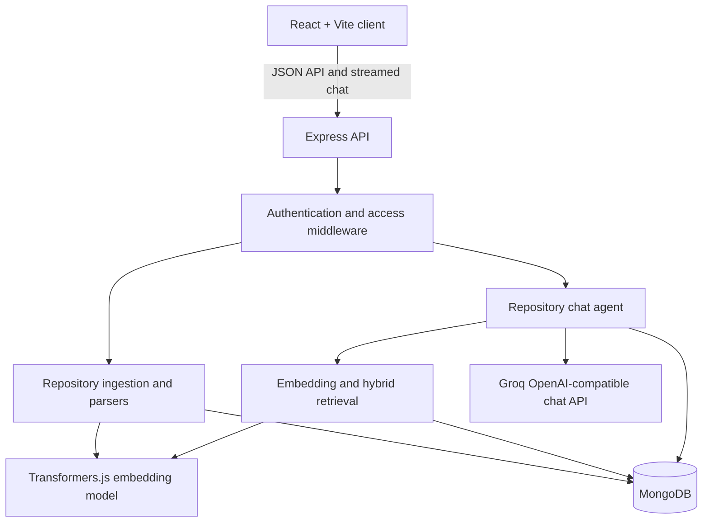

# Repo Insight AI

**A clearer view of your code.**

Repo Insight AI turns a GitHub repository into an explorable engineering workspace. It maps a codebase, surfaces its architecture and dependencies, and lets developers ask questions grounded in indexed source files.

**Created by Team Aeternis**

---

## Project overview

Understanding an unfamiliar repository takes time. Important routes, services, entry points, and dependencies can be spread across hundreds of files. Repo Insight AI brings that information together and provides a conversational way to explore it.

The platform analyzes a repository and gives developers:

- An architecture summary and onboarding guidance.
- Detected entry points, modules, dependencies, and technology stack.
- A map of likely request and execution paths.
- Repository-aware chat with related source files and suggested starting points.
- Separate, private repository and chat histories for each account.

## A guided repository workflow


## Product highlights

### Repository intelligence

Submit a public GitHub repository to build a searchable index. The ingestion pipeline filters unsuitable files, identifies common project structure, parses dependencies across Node.js, Python, Go, Rust, and Java projects, and creates semantic code chunks.

### Source-grounded chat

Ask questions in natural language. Repo Insight AI combines semantic similarity with matches from code and file paths, then streams a concise answer with relevant files. Chat history is session-based and scoped to the signed-in user.

### Account and access controls

- Email and password authentication, plus Google sign-in.
- User and admin roles; public registration creates standard user accounts.
- Repository and chat ownership checks.
- Terms of use acceptance before using protected project features.
- Automatic retention of each user’s 20 most recent chats and 10 most recent repositories.

### Operations and evaluation

- Health, readiness, and ping endpoints for service monitoring.
- Admin views for repository evaluation and observability.
- CI checks for server unit tests, client lint, and production build.

## How answers are produced

1. A user submits a GitHub URL.
2. The Express service clones and indexes the repository.
3. Parsers extract structural metadata and dependency information.
4. A local Transformers.js embedding model vectorizes selected source chunks.
5. Repository and embedding data are stored in MongoDB.
6. For a question, cached vectors and a hybrid semantic/lexical ranking identify useful code snippets.
7. The LLM receives the question, recent conversation, and retrieved repository evidence; its response streams to the chat interface.

The assistant is instructed to cite paths and to say when the indexed evidence is insufficient. Retrieval results are cached in bounded, short-lived in-memory caches to reduce repeated database and embedding work.

## System architecture



## Technology

| Area | Technologies |
| --- | --- |
| Web client | React 19, Vite, React Router, Redux Toolkit, Tailwind CSS, Material UI |
| API | Node.js, Express 5, Joi validation, cookie-based JWT authentication |
| Data | MongoDB and Mongoose |
| Repository analysis | simple-git, language-aware dependency and import parsers |
| Embeddings | Transformers.js, `onnx-community/all-MiniLM-L6-v2-ONNX` (384 dimensions) |
| Chat generation | Groq API through the OpenAI SDK, `openai/gpt-oss-120b` |
| Automation | GitHub Actions, Jest, ESLint, Vite production build |

## Repository layout

```text
client/
  src/components/       Shared interface and access components
  src/pages/            Authentication, exploration, and admin views
  src/redux/             Client authentication state
  src/services/          API clients
server/
  src/controllers/       HTTP request handlers
  src/routes/            API route definitions
  src/models/            Mongoose data models
  src/services/
    agents/               Repository Q&A and chat sessions
    analysis/             Architecture and execution-path analysis
    embeddings/           Source chunking and embedding generation
    evaluation/           Answer scoring and golden dataset evaluation
    parser/               Repository and language parsers
    repository/           Repository ingestion orchestration
    vector/               Cached hybrid retrieval and ranking
  tests/                  Server unit tests
.github/workflows/        Continuous integration
```

## Run locally

### Requirements

- Node.js 24 (CI uses Node.js 24)
- MongoDB connection string
- Groq API key for chat responses
- Google OAuth web client ID if Google sign-in is enabled

The embedding model is downloaded on first use and runs locally afterwards.

### Install dependencies

```bash
cd server
npm ci

cd ../client
npm ci
```

### Configure the server

Create `server/.env`:

```env
PORT=8080
NODE_ENV=development
MONGO_URL=mongodb://127.0.0.1:27017/repo-insight
MONGO_DB_NAME=repo-insight
FRONTEND_URL=http://localhost:5173
JWT_SECRET=replace_with_a_long_random_secret
LLM_API_KEY=your_groq_api_key
GOOGLE_CLIENT_ID=your_google_oauth_web_client_id

# Optional: bootstrap an admin account at server startup
ADMIN_EMAIL=admin@example.com
ADMIN_PASSWORD=use_a_unique_password_of_at_least_8_characters
ADMIN_NAME=Repo Insight Admin
```

Create `client/.env`:

```env
VITE_SERVER_URL=http://localhost:8080
VITE_GOOGLE_CLIENT_ID=your_google_oauth_web_client_id
```

Use a Google OAuth client configured for `http://localhost:5173` as an authorized JavaScript origin. Keep real secrets in local environment files or deployment secret storage; do not commit them.

### Start the application

In one terminal:

```bash
cd server
npm run dev
```

In a second terminal:

```bash
cd client
npm run dev
```

Open [http://localhost:5173](http://localhost:5173). The API runs at [http://localhost:8080](http://localhost:8080).

## API overview

Protected routes require an authenticated session. Repository and chat routes also require current terms acceptance. Evaluation and observability routes are admin-only.

| Method | Endpoint | Purpose |
| --- | --- | --- |
| `POST` | `/api/auth/signup` | Create a standard user account |
| `POST` | `/api/auth/login` | Sign in with email and password |
| `POST` | `/api/auth/google` | Sign in with Google |
| `GET` | `/api/auth/me` | Read the current session |
| `POST` | `/api/auth/accept-terms` | Record terms acceptance |
| `POST` | `/api/auth/logout` | End the current session |
| `GET` | `/api/repo` | List the signed-in user’s repositories |
| `POST` | `/api/repo` | Analyze a GitHub repository URL |
| `GET` | `/api/repo/:id` | Read an owned repository and its analysis |
| `DELETE` | `/api/repo/:id` | Delete an owned repository and its data |
| `POST` | `/api/chat/ask` | Ask a question; supports streamed chat responses |
| `GET` | `/api/chat/sessions` | List the signed-in user’s chat sessions |
| `GET` | `/api/health` | Read service health |
| `GET` | `/api/health/ready` | Check service readiness |
| `GET` | `/api/health/ping` | Lightweight uptime-monitor endpoint |
| `GET` / `POST` | `/api/evaluation/...` | Admin repository evaluation tools |
| `GET` | `/api/observability/...` | Admin operational metrics |

## Quality checks and CI

Run the checks locally:

```bash
cd server
npm test

cd ../client
npm run lint
npm run build
```

GitHub Actions runs the server unit tests and the client lint and production build on pushes, pull requests, and manual dispatches.

## Team

**Team Aeternis** built Repo Insight AI to make large codebases easier to understand, navigate, and discuss. The project brings repository parsing, retrieval, and conversational AI together in one developer-focused workspace.
